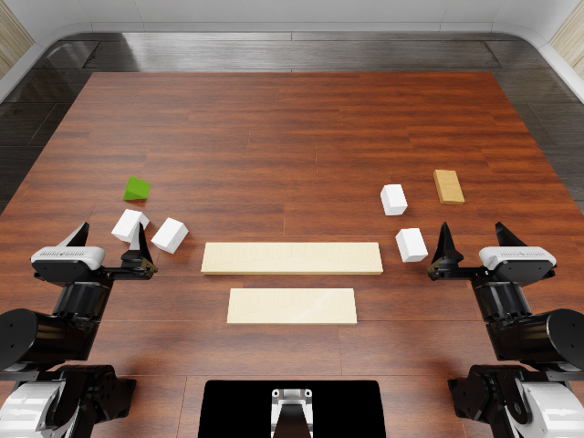
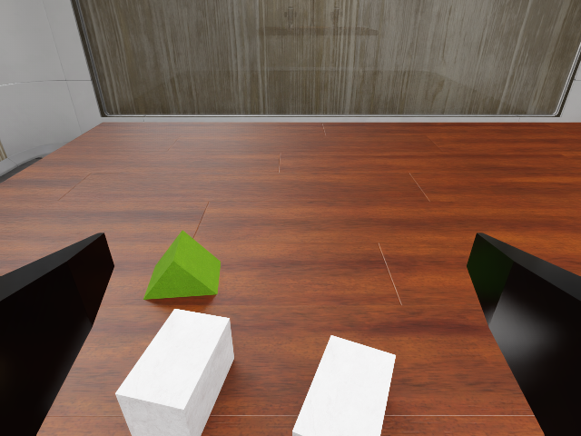
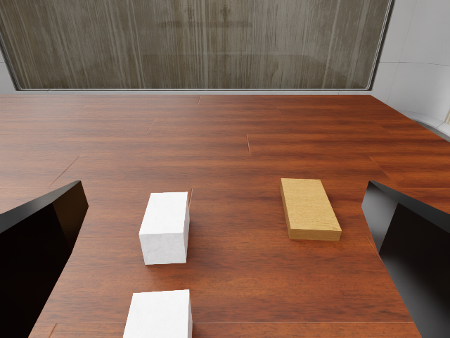
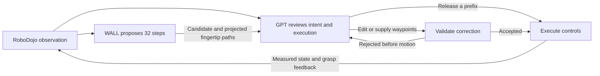

# PRIORA: Integrating Learned Action Priors into Generalist Robot Agents

When a generalist model can issue robot actions itself, what does a policy trained on demonstrations still contribute? PRIORA lets both models act in the same episode. **WALL proposes a trajectory. GPT inspects it before the robot moves**, then releases a prefix, edits it, or supplies its own waypoints. After execution, both models can use the resulting observation for the next decision.

[Project page and episode replays](https://echo-nn.github.io/PRIORA/) · [Agent architecture](docs/architecture.md) · [Run a task](docs/reproduction.md#run-a-task) · [Installation](docs/reproduction.md) · [Evaluation panels](docs/evaluation.md)

## One decision in RoboDojo

| Main camera | Left wrist | Right wrist |
| :---: | :---: | :---: |
|  |  |  |

*“Build a tower using the wooden blocks and wooden boards.”* These three RGB images come from the same observation at step 0. WALL proposed 32 dual-arm steps. For this integration check, the test harness released one step and RoboDojo acknowledged it. [Inspect the recorded decision](examples/build_tower/README.md)

## The control loop

| GPT decision | What the controller executes |
| --- | --- |
| Release | The first 1–16 steps of the current WALL proposal |
| Edit | A local correction to 1–5 steps of the proposal |
| Supply waypoints | GPT's dual-arm end-effector plan over 1–30 steps, checked with shared cuRobo kinematics |

The teacher compares what the previous motion accomplished with what the next proposal appears to do. It can preserve the current subtask through a failed grasp, or change the instruction when WALL pursues a different goal. The [architecture guide](docs/architecture.md) describes that handoff, camera geometry and episode memory.

## Explore the project

| To | Start here |
| --- | --- |
| Install the simulator, policy and teacher | [Reproduction guide](docs/reproduction.md) |
| Inspect a real input and executed action | [Tower example](examples/build_tower/README.md) |
| Select a layout or interpret a run | [Evaluation manifests](docs/evaluation.md) |
| Read what GPT actually receives | [Teacher prompt](priora/robodojo/wall_oss/teacher.md) and [tool definitions](priora/robodojo/wall_oss/client.py) |
| Follow the code from launch to execution | [Episode launcher](priora/cli.py) and [simulator adapter](priora/robodojo/wall_oss/session.py) |

PRIORA builds on GPT-as-Policy's synchronous review protocol and uses JustRUA's measured gripper observations. [Third-party notices](THIRD_PARTY_NOTICES.md)
