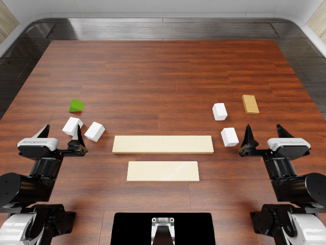
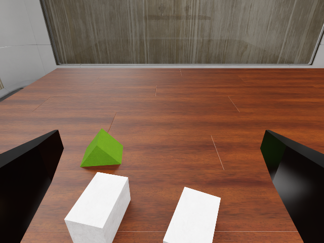
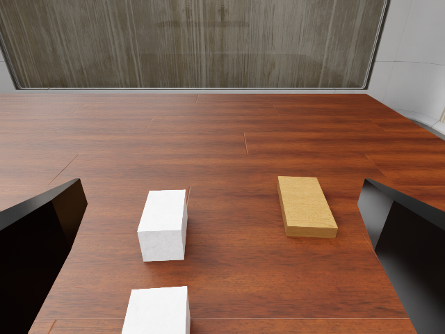

# A tower-building decision at step 0

**Instruction** — “Build a tower using the wooden blocks and wooden boards.”

The layout is `build_tower__standard__g0__l28` from the additional 210-episode panel. The first observation includes both arms at the edge of the table and wood pieces in the shared workspace. Open an image to inspect the original 640 × 480 pixels.

| Main RGB | Left wrist RGB | Right wrist RGB |
| :---: | :---: | :---: |
| [](cam_high.png) | [](cam_left_wrist.png) | [](cam_right_wrist.png) |

## What happened in the integration check

| Recorded quantity | Value |
| --- | --- |
| Policy instruction | Build a tower using the wooden blocks and wooden boards. |
| WALL proposal | 32 steps × 16 values per step |
| Mode selected by the integration test | `student` (release the WALL prefix) |
| Requested and acknowledged controls | 1 requested, 1 executed |
| Simulation step | 0 → 1 |
| Task outcome | Unscored. The check ended after this control |

The three images are the original RGB files for the initial observation. The normally configured teacher also receives depth and, where projection is available, separate annotated candidate views. This example exercises the WALL and simulator connection using a test-controlled release.

## Run the same layout with the teacher

After [installation](../../docs/reproduction.md), start the WALL service and run the command below in the controller environment.

```bash
priora run --robodojo "$ROBODOJO_ROOT" --sim-python "$SIM_PYTHON" \
  --case build_tower__standard__g0__l28 --output runs/tower
```

To inspect what the controller actually executed, read `runs/tower/controller/history.json`. For each entry, compare `response.steps` with `executed_steps` and read the interval from `start_tick` and `end_tick`. The corresponding `request_NNN.json` preserves the proposal reviewed at that step. [Run artifacts](../../docs/evaluation.md)
